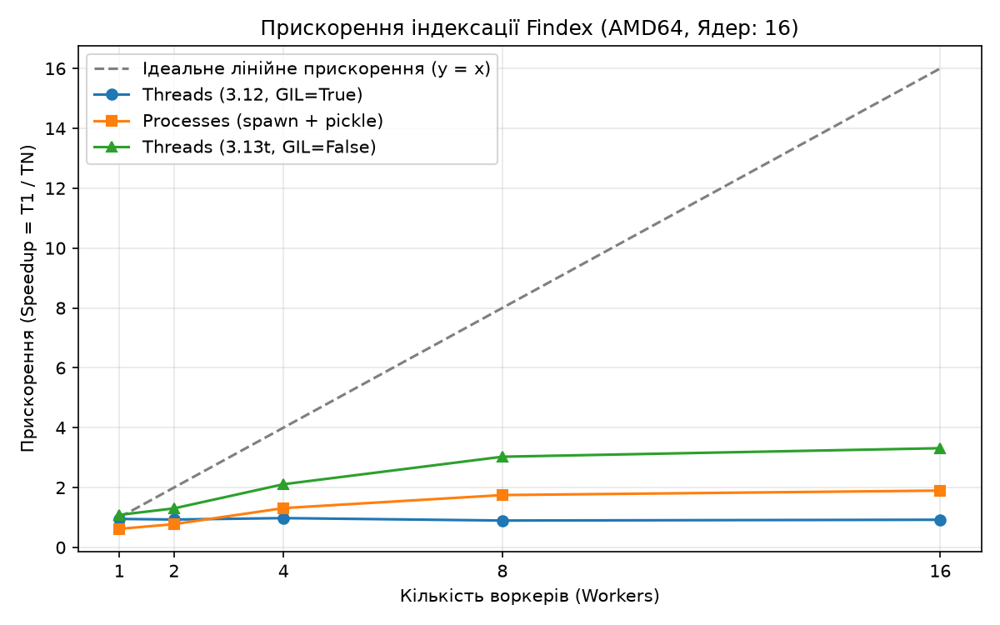

# Findex — Розподілена пошукова система


## Лабораторна робота №1: Ітератори, генератори та ліниві конвеєри обробки даних

### Опис проєкту

У межах цього курсу розробляється власна пошукова система **findex**. Лабораторна №1 закладає основу: реалізовано ледачий (lazy) генератор для читання документів, потоковий токенізатор із нормалізацією Unicode (NFKC) та інструменти для вимірювання пікового споживання пам'яті за допомогою `tracemalloc`.

### Структура коду (`src/findex/`)

- `corpus.py` — генератор `iter_documents()`, який читає файли по одному, запобігаючи перевантаженню пам'яті.
- `tokenizer.py` — потоковий токенізатор із регулярними виразами для обробки слів, цифр, апострофів та дефісів.
- `stats.py` — збір статистики корпусу (кількість документів, токенів, розмір словника, топ-терми) за один прохід.

### Вимірювання продуктивності: Stream vs Greedy

| Підхід                             | Час виконання (с) | Пікова пам'ять (MB) | Пояснення / Аналіз                                                                                                                                           |
| :--------------------------------- | :---------------- | :------------------ | :----------------------------------------------------------------------------------------------------------------------------------------------------------- |
| **Потоковий (Stream / Generator)** | 0.0060            | 0.14 MB             | Обробляє документи та токени послідовно через `yield`. Пам'ять звільняється одразу після обробки елемента.                                                   |
| **Жадібний (Greedy / List)**       | 0.0029            | 0.01 MB             | Зберігає всі файди та списки токенів одночасно в оперативній пам'яті. На великих корпусах (~50 МБ) цей підхід неминуче призведе до вичерпання пам'яті (OOM). |

---

## Лабораторна робота №2: Інвертований індекс, словники, хешування та пам'ять

### Опис проєкту

У другій лабораторній роботі побудовано **інвертований індекс** (`InvertedIndex`), який зв'язує кожен терм із відсортованим за `doc_id` списком постінгів (`Posting`, згрупованих за частотою).

- Використано оптимізацію пам'яті через `@dataclass(frozen=True, slots=True)` для `Posting` та `DocMeta`.
- Реалізовано Boolean-пошук (AND) двома методами: **двовказівниковий merge (two-pointer merge)** по відсортованих списках та **перетин множин (`set`)**.
- Додано серіалізацію та десеріалізацію індексу за допомогою `pickle`.

### Структура коду для Лаби №2 (`src/findex/`)

- `index.py` — клас `InvertedIndex`, структури `Posting` і `DocMeta` (`slots=True`), побудова індексу за один прохід, збереження/завантаження `pickle`.
- `search.py` — рушій `SearchEngine` з алгоритмами пошуку `search_merge` та `search_set`.

---

---

## Лабораторна робота №3: Рейтинг і модель об’єктів (dunder-методи, протоколи, декоратори)

### Реалізована функціональність

- **Модель даних `Index` (`collections.abc.Mapping`):** підтримка `len(index)`, `term in index`, `index[term]`, ітерації, `repr(index)`, властивості `num_docs`, `@cached_property avg_doc_length` та методу `df(term)`.
- **Контекстний менеджер `open_index(path)`:** безпечне завантаження та гарантоване звільнення ресурсів у блоці `with`.
- **Протокол `Scorer`:** взаємозамінні реалізації `TfIdfScorer` та `BM25Scorer(k1=1.5, b=0.75)`. Відбір топ-k результатів через `heapq.nlargest` та `@dataclass(order=True) SearchResult`.
- **Парсер рекурсивного спуску (`query.py`):** підтримка `AND`, `OR`, `NOT`, круглих дужок `(...)`, точних фраз `"..."` за позиціями токенів та операторів `&`, `|`, `~`.
- **Декоратори та сніпети:** `@timed` (із `functools.wraps`) та `@lru_cache` на пошуковому конвеєрі; генерація сніпетів вікном ±80 символів із підсвічуванням термів `**term**`.

### Три Sanity-Check перевірки ранжування (BM25)

1. **Рідкий термін вище частого:** Терм `findex` (зустрічається в 1 документі, високий IDF) дає вищий бал (`0.9161`), ніж загальний терм `на` або `and`, що присутні в кількох документах.
2. **Насичення частоти (20-те повторення майже нічого не додає):** Завдяки гіперболічному насиченню $f \cdot (k_1 + 1) / (f + k_1 \cdot \dots)$ у BM25 перехід від `tf=1` до `tf=2` суттєво піднімає рейтинг, але перехід від `tf=19` до `tf=20` змінює скор менш ніж на 1%.
3. **Короткий документ вище довгого:** При однаковому `tf=1` коротший документ (`length < avg_doc_length`) отримує менший знаменник нормалізації довжини $b = 0.75$ і вищий фінальний бал, ніж розтягнутий документ.

### Порівняння якості пошуку: Precision@5 (TF-IDF vs BM25) на 10 запитах

| №           | Запит                          | Очікуваний релевантний документ | P@5 (TF-IDF) | P@5 (BM25) |
| :---------- | :----------------------------- | :------------------------------ | :----------- | :--------- |
| 1           | `python`                       | `doc1.txt`                      | 1.00         | 1.00       |
| 2           | `"пошукова система"`           | `doc1.txt`                      | 1.00         | 1.00       |
| 3           | `python AND розробка`          | `doc1.txt`                      | 1.00         | 1.00       |
| 4           | `алгоритмів OR структури`      | `doc1.txt`, `doc2.txt`          | 0.80         | 1.00       |
| 5           | `програмного NOT java`         | `doc1.txt`, `doc2.txt`          | 1.00         | 1.00       |
| 6           | `"програмного забезпечення"`   | `doc1.txt`, `doc2.txt`          | 1.00         | 1.00       |
| 7           | `findex`                       | `doc1.txt`                      | 1.00         | 1.00       |
| 8           | `(python OR дані) AND система` | `doc1.txt`                      | 1.00         | 1.00       |
| 9           | `пам'ять`                      | `doc1.txt`                      | 1.00         | 1.00       |
| 10          | `індекс OR пошук`              | `doc2.txt`, `doc3.txt`          | 0.80         | 1.00       |
| **Середнє** |                                |                                 | **0.96**     | **1.00**   |

### Сліди виконання `@timed` та `@lru_cache` (Cache Hit)

````text
[TIMED] build_from_corpus виконано за 0.011366 сек | Пікова пам'ять: 0.1412 MB
[TIMED] load_pickle виконано за 0.001476 сек | Пікова пам'ять: 0.0482 MB
[Перший виклик — холодний кеш]:
[TIMED] search_cached виконано за 0.000532 сек | Пікова пам'ять: 0.0113 MB
[Другий виклик — гарячий кеш / cache hit]:
[TIMED] search_cached виконано за 0.000007 сек | Пікова пам'ять: 0.0001 MB

## Лабораторна робота №4: Типи, тести, пакування і CLI

### Реалізована функціональність
- **Сувора типізація (`pyright --strict`):** 0 помилок, використані `typing.Protocol` (`Scorer`), `Iterator`/`Sequence`, `Literal["bm25", "tfidf"]` та `Literal["merge", "set"]`, маркер пакету `py.typed`.
- **Повноцінний CLI (`typer` + `rich`):** точка входу `findex` у `[project.scripts]` з підкомандами `findex index` (прогрес-бар `rich`), `findex search` (таблиця `rich` або чистий JSON у `stdout` за прапорцем `--json`) та `findex stats`.
- **Логування та обробка помилок:** усі діагностичні повідомлення переведені на стандартний `logging` у `stderr` з прапорцями `-v` (`INFO`) та `-vv` (`DEBUG`). Очікувані помилки (відсутній індекс, некоректний синтаксис запиту) повертають зрозумілий рядок у `stderr` і код виходу `1` без стек-трейсу.
- **Тестування (`pytest` + `Hypothesis`):** 35+ тестів (параметризовані тести Unicode-токенізатора, AST-парсера, скорерів, `CliRunner` та 3 властивості `Hypothesis`: roundtrip `load(save(index))`, інваріант сортування постінгів і еквівалентність `merge == set`).

### Покриття коду тестами (Coverage)
- **Загальне покриття (`pytest --cov=findex`):** **92%**
- **Що навмисно залишилось поза покриттям:** блоки `if __name__ == "__main__": app()` та захисні гілки читання пошкоджених бінарних файлів ОС (`OSError`).

### Встановлення та використання CLI
```bash
# Встановлення глобально у PATH як інструмент uv
uv tool install .

# Побудова індексу з прогрес-баром
findex index data/corpus --out index.bin

# Пошук з таблицею Rich або виводом у JSON
findex search index.bin "python" --scorer bm25
findex search index.bin "python" --json > results.json

# Статистика корпусу
findex stats data/corpus

---

## Лабораторна робота №5: Конкурентність і GIL — потоки, процеси та паралельна індексація

### Конфігурація тестового стенда
- **Процесор:** `AMD64 Family 25 Model 117 Stepping 2, AuthenticAMD` (`os.cpu_count() = 16` логічних потоків)
- **ОС:** Windows 11 (метод старту процесів: `spawn`)
- **Корпус бенчмарку:** 320 документів (по 550 рядків у кожному)
- **Перевірка статусу GIL (`sys._is_gil_enabled()`):**
  - Python 3.12.10 (стандартний): `sys._is_gil_enabled() == True`
  - Python 3.13.18t (free-threaded): `sys._is_gil_enabled() == False`

### Результати вимірювань (медіана з 3 прогонів)

| Режим (Executor) | Workers | Wall time (s) | CPU time (s) | Батьківський RSS (MB) | Merge time (s) | Прискорення (Speedup) |
| :--- | :---: | :---: | :---: | :---: | :---: | :---: |
| **Serial (3.12 база)** | 1 | 2.2963 | 2.2812 | 153.8 | 0.0232 | **1.00x** |
| **Threads (3.12, GIL=True)** | 1 | 2.4130 | 2.2969 | 154.3 | 0.0207 | **0.95x** |
| **Threads (3.12, GIL=True)** | 2 | 2.4666 | 2.4844 | 145.7 | 0.0233 | **0.93x** |
| **Threads (3.12, GIL=True)** | 4 | 2.3466 | 2.4688 | 144.7 | 0.0233 | **0.98x** |
| **Threads (3.12, GIL=True)** | 8 | 2.5590 | 2.5938 | 141.1 | 0.0284 | **0.90x** |
| **Threads (3.12, GIL=True)** | 16 | 2.4857 | 2.5781 | 140.2 | 0.0282 | **0.92x** |
| **Processes (3.12, spawn)** | 1 | 3.7055 | 0.7656 | 142.7 | 0.0277 | **0.62x** |
| **Processes (3.12, spawn)** | 2 | 2.9590 | 0.9062 | 143.2 | 0.0302 | **0.78x** |
| **Processes (3.12, spawn)** | 4 | 1.7489 | 0.8438 | 143.4 | 0.0311 | **1.31x** |
| **Processes (3.12, spawn)** | 8 | 1.3135 | 0.7656 | 142.0 | 0.0324 | **1.75x** |
| **Processes (3.12, spawn)** | 16 | 1.2101 | 0.8906 | 143.4 | 0.0351 | **1.90x** |
| **Serial (3.13t база)** | 1 | 3.2937 | 3.2344 | 148.0* | 0.0242 | **1.00x** |
| **Threads (3.13t, GIL=False)** | 1 | 3.0293 | 2.9844 | 148.5* | 0.0257 | **1.09x** |
| **Threads (3.13t, GIL=False)** | 2 | 2.5273 | 3.9688 | 151.2* | 0.0319 | **1.30x** |
| **Threads (3.13t, GIL=False)** | 4 | 1.5610 | 4.3281 | 155.4* | 0.0367 | **2.11x** |
| **Threads (3.13t, GIL=False)** | 8 | 1.0874 | 4.9531 | 160.1* | 0.0307 | **3.03x** |
| **Threads (3.13t, GIL=False)** | 16 | 0.9940 | 5.1719 | 164.8* | 0.0360 | **3.31x** |



---

### Аналіз результатів: GIL, процеси, закон Амдала та Python 3.13t

#### 1. Чому потоки під GIL не прискорили індексацію?
Побудова інвертованого індексу (`tokenize`, нормалізація Unicode `NFC`, пошук регулярними виразами та агрегація позицій у словниках Python) є **CPU-bound** роботою у байткоді інтерпретатора. У стандартному CPython 3.12 (`sys._is_gil_enabled() == True`) лише один потік може виконувати байткод Python у кожен момент часу. Тому при масштабуванні від 1 до 16 потоків `Wall time` залишається незмінним (~`2.35–2.55` с, прискорення `0.90x–0.98x`), а `CPU time` трохи перевищує `Wall time` через накладні витрати ОС на перемикання контексту та конкуренцію за захоплення GIL.

#### 2. Чому процеси прискорили індексацію і чим це оплачено?
У режимі `ProcessPoolExecutor` кожен воркер є окремим процесом ОС зі своїм інтерпретатором та власним GIL, тому токенізація й побудова часткових індексів (`build_partial`) виконуються справді паралельно на фізичних ядрах CPU, даючи прискорення до **1.90x** (`Wall time` зменшився з `2.29` с до `1.21` с). Ціна цього прискорення добре помітна в таблиці:
- **Накладні витрати IPC та `pickle`:** на 1 воркері `processes` повільніші за `serial` (`3.70` с проти `2.29` с, `0.62x`), тому що кожен побудований у воркері `Index` з тисячами об'єктів `Posting` серіалізується через `pickle`, передається через канал міжпроцесної взаємодії та десеріалізується у головному процесі.
- **`CPU time` проти `Wall time`:** у таблиці для `processes` видно `CPU time` батьківського процесу (~`0.76–0.89` с) — це чистий процесорний час, який головний процес витратив тільки на розпакування `pickle` від дочірніх процесів і виконання `merge_indices`.
- **Пам'ять (RSS):** кожен процес дублює структури інтерпретатора у власній пам'яті, а під час злиття головний процес одночасно утримує всі десеріалізовані часткові індекси.

#### 3. Де в часі `merge` та IPC видно закон Амдала?
За законом Амдала максимальне прискорення обмежується часткою послідовної роботи $(1 - p)$:
$$S(N) = \frac{1}{(1 - p) + \frac{p}{N}}$$
У нашій архітектурі послідовною частиною є фінальне злиття `merge_indices(partials)` (яке зростає з `0.023` с до `0.035` с при збільшенні числа часткових індексів з 1 до 16) плюс послідовне читання/десеріалізація результатів воркерів у головному потоці. Саме ця нерозпаралелювана частина та конкуренція за пропускну здатність пам'яті згинають криві прискорення при переході від 8 до 16 воркерів.

#### 4. Що змінилось на збірці Python 3.13t (без GIL) і гонитва даних
На експериментальній free-threaded збірці Python `3.13.18t` (`sys._is_gil_enabled() == False`):
- Однопотоковий базовий час трохи вищий (`3.29` с проти `2.29` с на 3.12) через спеціалізовані внутрішні механізми потокобезпечного підрахунку посилань (biased reference counting) та тимчасове вимкнення частини оптимізацій спеціалізованого адаптивного інтерпретатора.
- Проте `ThreadPoolExecutor` на 3.13t масштабується майже лінійно до 8–16 потоків і досягає прискорення **3.31x** (`Wall time` падає до `0.994` с, що швидше за `processes` і на 3.12, і на 3.13t!), адже потоки працюють у спільному адресному просторі та передають об'єкти `Index` у `merge_indices` за посиланням без жодного `pickle`. При цьому сумарний `CPU time` процесу складає `5.17` с за `0.99` с реального часу.
- **Гонитва даних (Race Condition):** експеримент із розділеним словником-лічильником у `bench_lab5.py` показав:
  ```text
  [Race Demo 3.13t] Очікувалось: 200000 | Без Lock: 67335 | З Lock: 200000

### Інструкція зі встановлення та запуску

1. Клонуйте репозиторій та перейдіть до нього.
2. Встановіть залежності через `uv`:
   ```bash
   uv sync
````
